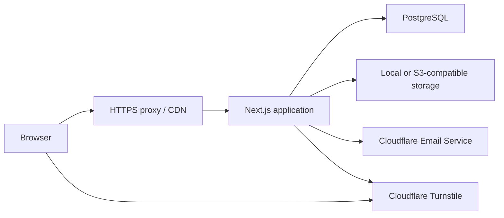
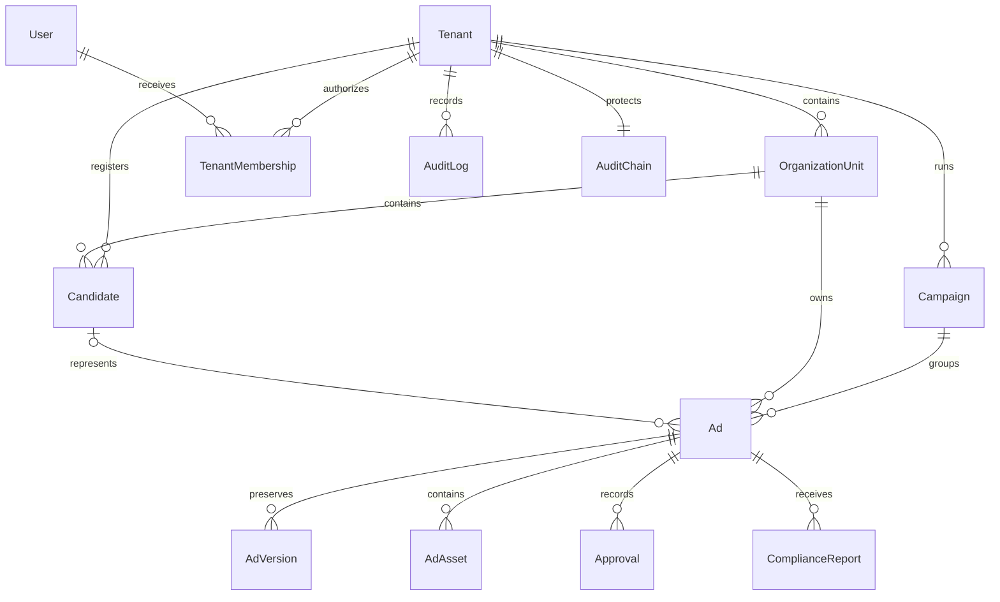

# Adclare Maintainer Handoff

This document is the technical and product handoff for Adclare. It explains
what the application does, how the main workflows fit together, where the
important code lives, how to run and release it, and which risks remain.

The handoff is public-safe. It intentionally contains no passwords, API tokens,
private keys, server addresses or private infrastructure identifiers.

**Handoff date:** 26 July 2026  
**Target version:** `v0.2.0-beta.5`  
**Official repository:** <https://github.com/lukashanes/adclare.eu>  
**Owner:** Lukáš Hanes  
**Support:** `support@adclare.eu`  
**License:** EUPL-1.2

## 1. Product Purpose

Adclare is an open source application for managing political advertising under
the EU Transparency and Targeting of Political Advertising Regulation (TTPA),
Regulation (EU) 2024/900.

The product replaces disconnected spreadsheets, email approvals, file folders
and separately generated QR codes with one controlled workflow:

1. Register an advert and its campaign context.
2. Complete the required TTPA information.
3. Upload the final creative asset.
4. Generate the QR and transparency package.
5. Review, approve and publish the advert.
6. Expose the public transparency notice and repository record.
7. Preserve versions, approvals and an auditable export.

Adclare supports the compliance process. It does not provide legal advice or
automatically guarantee that every use of an advert complies with applicable
law. The deploying organization remains responsible for its legal assessment,
data quality, publication timing and required external submissions.

## 2. Intended Users

- Political party headquarters and compliance teams.
- Regional and local party organizations.
- Campaign managers and candidates.
- External designers and agencies.
- Reviewers and read-only auditors.
- Organizations that host and operate Adclare for their own users.

The installation is multi-organization at the database level. Every operational
record belongs to a tenant and access is further limited by role, organization
unit or candidate assignment.

## 3. Current Delivery State

Three states must always be checked separately:

| State | Source of truth | How to verify |
| --- | --- | --- |
| Source candidate | Git commit and clean working tree | `git status`, `git log -1` |
| Official release | Owner-controlled tag and GitHub Release | GitHub Releases and `git tag --points-at HEAD` |
| Running production | Deployed image, migrations and live smoke | `/api/health`, deployed image metadata, `npm run launch:smoke` |

The package currently targets `0.2.0-beta.5`. Treat it as a release candidate
until all gates in section 14 pass, the exact commit is tagged by an authorized
maintainer, and that same commit is verified in production.

Passing a local build is not evidence that the same code is running publicly.
Record the deployed Git commit or release tag with every deployment.

### Verification Recorded at Handoff

On 26 July 2026, the current working tree passed:

- `npm run ci`, including 16 Playwright tests, security scan, lint, type check,
  dependency audit and production build,
- `npm run docker:check`, including the migrator, storage check, production
  preflight and web image targets,
- Markdown link, whitespace and common secret-pattern checks for this handoff.

Production preflight, live smoke, real email, Turnstile, storage and restore
verification are intentionally not claimed by this local result. They must be
run against the final deployed environment.

## 4. Architecture



### Runtime

- Next.js 16 App Router.
- React 19 and TypeScript.
- PostgreSQL 17.
- Prisma 7 with the PostgreSQL adapter.
- Tailwind CSS 4.
- Local disk or S3-compatible asset storage.
- Cloudflare Email Service for transactional email.
- Cloudflare Turnstile for public form protection.
- Docker and Docker Compose for self-hosted deployment.

### Important Directories

| Path | Responsibility |
| --- | --- |
| `src/app/[locale]` | Czech and English public website, help and legal pages |
| `src/app/app` | Authenticated workspace UI |
| `src/app/api/app` | Authenticated workspace API |
| `src/app/api/public` | Public per-advert API and discrepancy reports |
| `src/app/ad/[code]` | Public transparency notice and report form |
| `src/app/repo/[tenant]` | Public repository |
| `src/lib/workspace-db.ts` | Main workspace domain and persistence layer |
| `src/lib/workspace/services` | Extracted domain services |
| `src/lib/ttpa-completeness.ts` | TTPA completeness rules |
| `src/lib/compliance-reports.ts` | Public discrepancy report rules |
| `src/lib/cloudflare-email.ts` | Transactional email adapter |
| `src/lib/object-storage.ts` | Asset storage abstraction |
| `prisma/schema.prisma` | Database schema and role enums |
| `prisma/migrations` | Ordered production database migrations |
| `tests/e2e` | Playwright browser workflows |
| `scripts` | Preflight, smoke, backup, restore and security checks |
| `docs` | Setup, operations, releases and roadmap |

## 5. Core Data Model

The main domain relationships are:



Additional authentication and operational models are `LoginToken`,
`UserSession`, `Invitation`, `EmailMessage` and `RateLimitBucket`.

### Advert State

`AdWorkflowStatus` controls the operational process. The important transitions
are draft, ready for review, changes requested, approved, published and
archived. A published advert is locked. Later changes create a new version
instead of silently replacing the published record.

Every published advert receives a stable, unguessable public token. Do not
replace it with sequential IDs or human-readable codes.

### TTPA Record

The advert record captures, as applicable:

- sponsor, payer and controlling entity identity and contact details,
- funding source, amount, currency and calculation method,
- campaign, election, dissemination period, location and language,
- channel, publisher platform and online advert URL,
- targeting, personal-data use and intended or measured reach,
- creative assets and public transparency notice,
- optional external repository URL when available.

The completeness service is the single place for deciding which required data
is missing before review or publication. UI-only validation is not sufficient.

## 6. Roles and Access

Access is enforced on the server. Hiding a control in the UI is not an
authorization boundary.

| Role | Scope | Main permissions |
| --- | --- | --- |
| `SUPER_ADMIN` | All tenants | All tenant and platform administration |
| `PARTY_ADMIN` | Whole tenant | Users, settings, branches, campaigns, adverts, approval, publication and exports |
| `CENTRAL_REVIEWER` | Whole tenant | Review, approval, publication, audit and exports |
| `READONLY_AUDITOR` | Whole tenant | Scoped reading, audit and exports |
| `LOCAL_ADMIN` | Assigned organization unit | Adverts, candidates, local users, own unit details and scoped exports |
| `CAMPAIGN_MANAGER` | Assigned organization unit | Adverts and candidates in the assigned unit |
| `DESIGNER` | Assigned organization unit | Read assigned records and upload assets |
| `CANDIDATE` | Assigned candidate | Create and edit only the candidate's adverts |

Only `SUPER_ADMIN`, `PARTY_ADMIN` and `CENTRAL_REVIEWER` can approve or publish.
Only `SUPER_ADMIN` and `PARTY_ADMIN` can manage tenant settings, branches and
campaigns. A local administrator can edit the assigned organization unit and
manage users inside that scope.

All roles can see audit events allowed by their scope. Audit and archive exports
are available to central administrators, reviewers, auditors and local
administrators within their permitted data.

When adding a role or permission, update and test all three layers:

1. server permission helper,
2. query scope,
3. UI capability.

## 7. Main User Workflows

### First Installation

1. Set `SIGNUP_MODE=first-run`.
2. Open `/signup`.
3. Create the first organization and administrator.
4. Verify the magic-link email and sign in.
5. Change `SIGNUP_MODE=disabled` if additional public workspace creation is not
   intended.

Additional users are invited from the workspace. Production must never rely on
login links being printed to logs.

### Workspace Setup

1. Configure organization identity and public repository settings.
2. Create organization units using the customer's preferred hierarchy and
   names.
3. Create campaigns and tags.
4. Add candidates.
5. Invite users and assign roles and scope.

### Advert Workflow

1. Create an advert.
2. Complete all applicable TTPA fields.
3. Resolve missing-data warnings before the planned publication date.
4. Upload the creative asset.
5. Download the QR package for the creative workflow.
6. Submit for review.
7. Approve or return the advert for changes.
8. Publish it and verify the public notice.

The QR package contains the formats and manifest needed by designers and
printers. The public URL must resolve to the advert's transparency notice.

### Public Transparency

- `/ad/[code]` displays the public transparency notice.
- `/api/public/ads/[code]` exposes the machine-readable advert record.
- `/repo/[tenant]` lists published and archived adverts.
- `/api/repo/[tenant]/ads` exposes the paginated repository data.
- `/ad/[code]/report` lets a member of the public report an inconsistency.

Unpublished advert APIs must not disclose private data. The pending HTML view
must not reveal the internal advert record.

### Imports and Exports

- Existing registers can be imported from XLSX.
- Invalid import rows return actionable validation errors.
- QR packages, advert audit packages and workspace archives contain manifests
  and SHA-256 integrity data.
- Workspace archives include CSV and JSON audit history within the user's
  authorized scope.

## 8. Auditability

Important changes and sensitive reads are written to an append-only audit log.
Each event records the actor, role, scope, action, entity, outcome, request
context and structured before/after data when applicable.

The database maintains a per-tenant sequence and hash chain:

- `previousHash` links an event to the preceding event,
- `entryHash` protects the canonical event payload,
- `sequence` establishes order,
- `AuditChain` stores the tenant chain head.

Database triggers prevent ordinary update and delete operations on audit rows.
Exports verify chain continuity and include the result in their manifest.

Never place passwords, session cookies, magic-link tokens, API tokens, complete
files or other secrets in audit metadata.

## 9. Authentication and Security

- Authentication uses expiring, single-use magic links.
- Session records are stored in PostgreSQL and the browser receives an
  `HttpOnly` session cookie.
- Invitation tokens and login tokens are stored as hashes.
- Public mutation forms are rate limited and can require Turnstile.
- Tenant, organization-unit and candidate scope is applied in server queries.
- Uploaded assets are private by default and downloaded through authorized
  routes.
- Security headers are set by the application. The HTTPS terminator should own
  HSTS and must not duplicate or conflict with application policy headers.
- The repository security scan rejects known secret patterns and unsafe
  production configuration.

Known security limitations are listed in section 16.

## 10. Email, Storage and External Services

### Email

Transactional email uses the Cloudflare Email Service REST API. It is used for:

- login links,
- invitations and retries,
- public discrepancy report receipts,
- report resolution notifications.

Configure `EMAIL_FROM`, `CLOUDFLARE_EMAIL_ACCOUNT_ID` and
`CLOUDFLARE_EMAIL_API_TOKEN`. Verify sender-domain authorization and real
delivery after every production configuration change.

### Storage

`ADCLARE_STORAGE_DRIVER` selects:

- `local` for persistent filesystem storage,
- `s3` for Hetzner Object Storage or another S3-compatible service.

Local Docker storage must use a persistent volume. S3 production configuration
must pass `npm run storage:check` before users upload files.

The database and asset storage are separate backup domains. A database backup
alone is not a complete Adclare backup.

### Turnstile

For a public instance, set `TURNSTILE_REQUIRED=1`, configure the site and secret
keys, and restrict `TURNSTILE_ALLOWED_HOSTNAMES` to the real public hostnames.

## 11. Local Development

Requirements:

- Node.js 20.19 or newer,
- Docker with Compose,
- Git.

Start from a clean clone:

```bash
git clone https://github.com/lukashanes/adclare.eu.git
cd adclare.eu
cp .env.example .env
npm ci
docker compose up -d db
npm run db:migrate
npm run db:generate
npm run dev
```

Open `http://localhost:3000`.

For sample data:

```bash
npm run db:seed
```

The seed creates a demo workspace and users. Do not run it against production.

## 12. Configuration Ownership

The complete variable reference is in
[`docs/configuration.md`](configuration.md). In summary:

| Area | Required production decision |
| --- | --- |
| URLs | Canonical HTTPS application URL and proxy hostname |
| Database | Unique strong credentials and persistent PostgreSQL storage |
| Signup | `first-run`, `open` or `disabled` |
| Email | Authorized sender, Cloudflare account and scoped API token |
| Turnstile | Required mode, widget keys and allowed hostnames |
| Storage | Persistent local volume or verified private S3 bucket |
| Upload limits | Maximum accepted advert asset size |
| Support | Public support address |

Secrets belong only in the deployment secret store or a protected server
environment file. Keep `.env`, database dumps, storage credentials and private
keys outside Git.

## 13. Test Strategy

The main command is:

```bash
npm run ci
```

It runs:

- launch and configuration smoke tests,
- audit-chain and scoped audit-query tests,
- database-backed workflow tests,
- Playwright browser E2E tests,
- repository security scan,
- Prisma schema validation and client generation,
- lint and TypeScript checks,
- production dependency audit,
- production Next.js build.

`npm run docker:check` builds the migrator, storage check, preflight and web
images.

The Playwright pass-through covers the public website, authentication helpers,
workspace administration, invitation acceptance, advert validation, upload,
QR package, approval, publication, public transparency, XLSX import, audit
exports and role scopes.

Do not weaken a failing release test only to make CI green. First determine
whether the failure is product behavior, test isolation, environment state or
an incorrect expectation.

## 14. Release and Deployment Runbook

### Release Gate

From the exact commit to be released:

```bash
npm ci
npm run ci
npm run docker:check
npm run launch:preflight
```

For S3-compatible production storage:

```bash
npm run storage:check
```

Before tagging:

1. Confirm the working tree is clean.
2. Review the full diff for secrets and unrelated generated files.
3. Confirm migrations apply to a fresh empty database.
4. Create and restore a database backup in a non-production database.
5. Restore or validate an asset backup.
6. Verify release notes and changelog match the package version.
7. Record the commit SHA selected for deployment.

Only an authorized maintainer creates the official tag:

```bash
git tag vX.Y.Z
git push origin vX.Y.Z
```

### Deployment Order

1. Back up PostgreSQL and assets.
2. Build or pull the image for the tagged commit.
3. Run `prisma migrate deploy` through the migrator image.
4. Run the production preflight with the real environment.
5. Start the web service.
6. Confirm `/api/health`.
7. Run `npm run launch:smoke`.
8. Verify login email, invitation email and public report email.
9. Upload and download a real test asset.
10. Complete one advert from draft through public notice.
11. Inspect final response headers after the proxy and CDN.
12. Record deployed tag, commit, migration status and test result.

### Rollback

Application rollback and database rollback are different operations.

- Keep the previous application image until the new deployment is verified.
- Prisma migrations are forward migrations. Do not manually edit migration
  history or run destructive SQL during an incident.
- If a migration must be reversed, restore the verified pre-deployment database
  and matching asset backup, then run the matching previous application image.
- Record the incident and preserve logs before cleanup.

## 15. Operations

### Daily

- Check `/api/health`.
- Check application and database container health.
- Review failed email records and user-reported delivery issues.
- Review storage availability and disk capacity.

### Weekly

- Confirm fresh database and asset backups.
- Review unresolved compliance reports and their deadlines.
- Review warnings and unusual audit events.
- Check dependency and CI alerts.

### Monthly

- Restore a recent backup into an isolated environment.
- Verify audit-chain integrity.
- Review active users, invitations and role scopes.
- Review Turnstile, email and object-storage credentials.
- Apply supported dependency and base-image updates through a tested release.

### Health and Troubleshooting Order

When the application is unavailable, check:

1. DNS and TLS.
2. Reverse proxy or CDN response.
3. Web container health and logs.
4. Database connectivity and migration state.
5. Asset storage connectivity.
6. Email provider only if the application works but sign-in or invitations do
   not arrive.

Do not restart or delete data before collecting the smallest useful logs and
confirming the failed layer.

## 16. Known Gaps and Technical Debt

These items are not hidden product status messages. They are maintainer work.

### Release-Critical Before `v0.2.0-beta.5`

1. Run the complete CI and Docker gates on the final, clean commit.
2. Verify the final migrations on both a fresh database and a copy of the
   intended production schema.
3. Perform and record a database restore and asset restore drill.
4. Ensure the reverse proxy does not duplicate or conflict with application
   security headers.
5. Verify production email, Turnstile and the selected storage driver.
6. Deploy the tagged commit and prove it with health, live smoke and the full
   advert workflow.

### Product and Compliance Follow-up

- The machine-readable public advert record is an Adclare JSON profile. Map it
  to the final official European repository schema and submission API when the
  authoritative integration specification is available.
- Public transparency and report pages need full Czech and English parity.
- Data retention duration is configurable metadata, but automatic retention
  and deletion jobs are not implemented.
- Two-factor authentication is not implemented. Magic-link authentication is
  the current baseline.
- A legal specialist should review the final privacy, data-processing,
  retention and TTPA wording for each real deployment and jurisdiction.
- Compliance report deadlines and escalation should gain dedicated automated
  tests and optional notifications.

### Engineering Follow-up

- `src/app/app/AppWorkspaceClient.tsx` is still too large. Continue splitting it
  into workspace hooks and focused panels.
- `src/lib/workspace-db.ts` remains a large domain monolith. Move ads, users,
  campaigns, branches, exports and public repository behavior into real
  services instead of re-export shims.
- Advert, public repository and audit queries are paginated. Campaigns,
  candidates and the people directory still need server pagination and search
  for very large organizations.
- Email is persisted, but there is no dedicated background retry worker for
  transient delivery failures.
- Deployment is documented and containerized, but there is no official
  automated GitHub-to-production deployment workflow.
- Expand integration tests for retention, mail retries, object-storage failure
  recovery and proxy-level security headers.

## 17. Production Acceptance Checklist

An instance is ready for real users only when all answers are yes:

- [ ] The deployed commit matches an official owner-controlled release.
- [ ] Production migrations completed successfully.
- [ ] `/api/health` reports the application and database healthy.
- [ ] Production preflight and live smoke pass.
- [ ] Login and invitation emails arrive.
- [ ] Turnstile works on real public hostnames.
- [ ] Advert upload and authorized download work.
- [ ] QR links open the correct public transparency notice.
- [ ] An incomplete advert cannot be published.
- [ ] Approval, publication and later versioning work.
- [ ] Candidate and local users cannot access records outside their scope.
- [ ] The public repository exposes only published or archived records.
- [ ] Audit and workspace exports contain valid manifests and audit-chain data.
- [ ] Database and asset backups are current.
- [ ] A restore has been tested outside production.
- [ ] Final security headers appear once and do not conflict.
- [ ] Operational ownership and incident contact are assigned.

## 18. Handoff Package

The next maintainer should receive access to these systems through secure,
out-of-band sharing:

- repository owner or collaborator access,
- production host access,
- DNS, proxy, Turnstile and email administration,
- object-storage administration,
- backup location and restore credentials,
- domain and support mailbox ownership,
- incident contact and legal/compliance contact.

Do not place access credentials in an issue, pull request, wiki page, repository
file or chat transcript.

The handoff is complete only after the receiving maintainer can independently:

1. start a clean local installation,
2. run the full test suite,
3. find and interpret an audit event,
4. restore a backup,
5. deploy a tagged version,
6. complete the advert workflow,
7. locate the known gaps in section 16.
